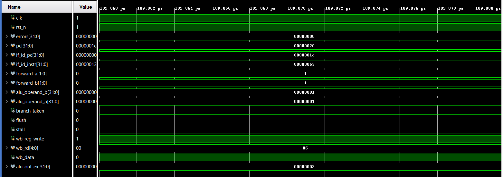

# 32-bit RISC-V 5-Stage Pipelined Processor (Verilog)

A 5-stage pipelined 32-bit RISC-V processor core written in Verilog RTL, with data forwarding, load-use stall detection and branch flushing. Simulated and verified in Xilinx Vivado.



## Features

- **Classic 5-stage pipeline:** IF, ID, EX, MEM, WB with IF/ID, ID/EX, EX/MEM and MEM/WB pipeline registers.
- **Data forwarding:** EX/MEM and MEM/WB results are forwarded to the ALU inputs to resolve RAW hazards.
- **Load-use hazard detection:** inserts a 1-cycle stall (freezes PC and IF/ID, bubbles ID/EX).
- **Control hazards:** branches resolve in EX; a taken branch flushes IF/ID and ID/EX.
- **Modular design:** separate ALU, register file, immediate generator, control unit, forwarding unit, hazard unit, instruction memory and data memory.

## Supported instructions

| Type | Instructions |
|------|--------------|
| R-type | `ADD SUB AND OR XOR SLL SRL SRA SLT SLTU` |
| I-type ALU | `ADDI ANDI ORI XORI SLTI` |
| Memory | `LW SW` (word access only) |
| Branch | `BEQ` (taken when ALU `SUB` result is zero) |

Not implemented yet: `BNE/BLT/BGE`, `JAL/JALR`, `LUI/AUIPC`, shift-immediates, byte/halfword loads and stores.

## Repository structure

```
.
├── rtl/
│   ├── riscv_top.v          # Top level: datapath, pipeline registers, wiring
│   ├── alu.v                # 32-bit ALU
│   ├── control_unit.v       # Opcode / funct decoder
│   ├── regfile.v            # 32x32 register file (x0 = 0, writes on negedge clk)
│   ├── imm_gen.v            # Immediate generator
│   ├── forwarding_unit.v    # Forwarding mux selects
│   ├── hazard_unit.v        # Load-use stall and branch flush
│   ├── instr_mem.v          # Instruction memory (loads program.hex)
│   └── data_mem.v           # Data memory (word-addressed)
├── tb/
│   └── tb_riscv_top.v       # Testbench with VCD dump
├── sim/
│   ├── program.hex          # Test program
│   └── run_sim.sh           # Icarus Verilog run script
├── docs/
│   ├── Waveform_Guide.md    # Which signals to inspect for each hazard
│   └── images/waveform_vivado.png
├── LICENSE
└── README.md
```

## Running the simulation

### Icarus Verilog + GTKWave

```bash
cd sim
chmod +x run_sim.sh
./run_sim.sh
gtkwave riscv_sim.vcd
```

Run from the `sim/` folder: `instr_mem.v` loads `program.hex` using a relative path.

### Xilinx Vivado

1. Create a new RTL project and add everything in `rtl/` as design sources.
2. Add `tb/tb_riscv_top.v` as a simulation source and set `tb_riscv_top` as the simulation top.
3. Add `sim/program.hex` as a **simulation source** (or replace the path in `instr_mem.v` with an absolute path) so `$readmemh` can find it.
4. Run Behavioral Simulation and add signals such as `pc`, `if_id_instr`, `forward_a`, `forward_b`, `stall`, `flush`, `branch_taken`, `wb_rd`, `wb_data` and `alu_out_ex` to the waveform.

## Test program

`sim/program.hex` exercises R-type and I-type arithmetic, back-to-back RAW dependencies (forwarding), `SW`/`LW` with a dependent instruction (load-use stall), and ends in a `BEQ x0, x0, 0` self-loop (branch flush).

| Address | Hex | Instruction |
|---------|-----|-------------|
| 0x00 | `00500113` | `addi x2, x0, 5` |
| 0x04 | `00a00193` | `addi x3, x0, 10` |
| 0x08 | `00310233` | `add  x4, x2, x3` |
| 0x0C | `004182b3` | `add  x5, x3, x4` |
| 0x10 | `00502023` | `sw   x5, 0(x0)` |
| 0x14 | `00002303` | `lw   x6, 0(x0)` |
| 0x18 | `006303b3` | `add  x7, x6, x6` |
| 0x1C | `00000063` | `beq  x0, x0, 0` |

## Notes

- The `errors` output is currently tied to 0; the testbench prints it but does not yet compare register or memory contents against expected values. Adding self-checking assertions would be a good next step.
- Forwarding select encoding: `2'b10` = from EX/MEM, `2'b01` = from MEM/WB, `2'b00` = no forwarding.

## License

MIT, see [LICENSE](LICENSE).
