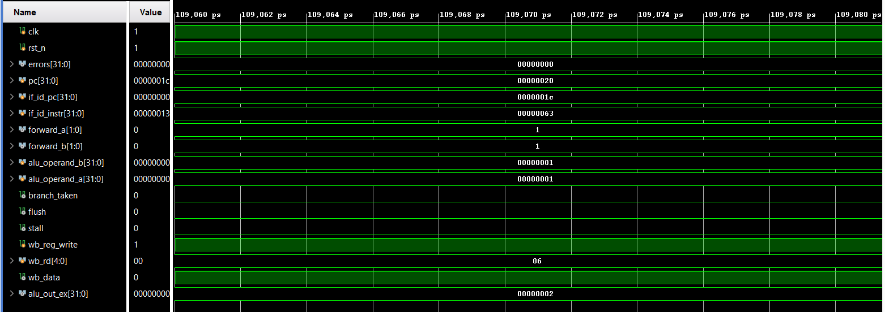

# Waveform Debugging & Verification Guide

When demonstrating this project in Vivado or GTKWave, inspect these critical internal pipeline signals to prove core functionality.

---

## 1. Verifying Read-After-Write (RAW) Forwarding
- **Signals to add:** `id_ex_rs1`, `id_ex_rs2`, `ex_mem_rd`, `forward_a`, `forward_b`, `alu_operand_a`, `alu_operand_b`
- **Expected Behavior:** 
  - When an instruction in EX stage reads a register updated by an instruction in EX/MEM stage, `forward_a` or `forward_b` changes from `2'b00` to `2'b10` (EX/MEM) or `2'b01` (MEM/WB).
  - The ALU input (`alu_operand_a`) immediately reflects `ex_mem_alu_out` without waiting for Write-Back.

---

## 2. Verifying Load-Use Hazard Stall
- **Signals to add:** `id_ex_mem_read`, `id_ex_rd`, `if_id_instr`, `stall`, `pc`
- **Expected Behavior:**
  - When `LW` is in EX stage and the next instruction in ID stage consumes its `rd`, `stall` goes `HIGH` for 1 clock cycle.
  - `pc` and `if_id_pc` freeze.
  - `id_ex_instr` is replaced with `0x00000013` (NOP bubble).

---

## 3. Verifying Control Hazard Branch Flush
- **Signals to add:** `branch_taken`, `flush`, `pc`, `if_id_instr`
- **Expected Behavior:**
  - When `branch_taken` evaluates `HIGH` in EX stage, `flush` goes `HIGH`.
  - The speculatively fetched instructions in `IF/ID` and `ID/EX` registers are converted to `0x00000013` (NOP).
  - `pc` jumps to the target branch address.

---

## Example capture

Around 109 ns the program is parked in the `beq x0, x0, 0` self-loop (`if_id_instr = 00000063`). `forward_a` and `forward_b` are `1` (forwarding from MEM/WB), `wb_rd = 06` and `alu_out_ex = 2`.
